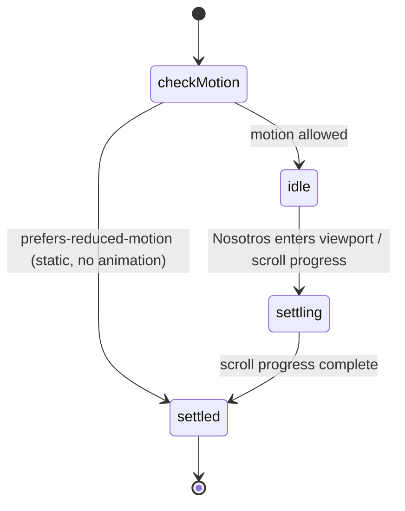

# Decisions

The page is a static Vite and React site. There is no CMS, no auth, and no stored contact form.

WhatsApp is the only call to action. `Agenda una primera llamada` and `Hablemos` open `https://wa.me/50258713903`. Mail is `mailto:info@koisoftware.com`. Instagram is `https://instagram.com/carloshugoeg`.

Nosotros is ink variant B1, four torn sheets with tape. There is no "Probado en casa" card and no project-count placeholder, because B1 closes on the stamp and `Agenda una primera llamada`. Contacto is C3, the dark close `Empecemos por la primera ronda`, with the koi in negative and a dark footer. C1 and C2 are not shipped. B2 and B3 are not shipped.

The stack stays Vite, React, and TypeScript, deployed as a Vercel preview until Carlos approves production.

## Nosotros motion

`stepNosotros` in `src/ink/motion.ts` is that chart. Reduced motion probes straight to `settled`, sets every sheet to its final place, and turns transitions off. With motion allowed, the section waits in `idle` until it enters the viewport, stays in `settling` while the sheets catch up to the scroll, and reaches `settled` when each sheet has finished. The section exposes the phase as `data-phase`.

Contact links have no in-page state. A tap leaves the page for WhatsApp, mail, or Instagram.

## Copy rules from the handoff

The visible page does not name a city. Public product names are KoiPOS and Nutrea. NeuroMenu is not on the page. The project count stays unpublished because B1 has nowhere to put `[N proyectos entregados]`.

The visual source is ink's final bundle, which replaces the r17/r19 mockup. That `index.html` already defaults to B1 and C3. Its hero sentence still says "en Guatemala". HANDOFF.md and issue #5 both say not to name a city, so the shipped sentence is "Estudio de software. Sistemas tranquilos y precisos para negocios locales." The pre-script footer in that file also names Guatemala; the C3 script replaces it, and the shipped footer is that replacement: "Estudio integral de software".
